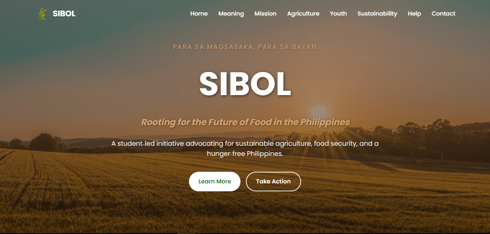

# SIBOL - Para sa Magsasaka, Para sa Bayan

**Rooting for the Future of Food in the Philippines**

SIBOL is a student-led initiative that advocates for sustainable agriculture, food security, and a hunger-free Philippines. Through information and community engagement, the project aims to highlight the importance of agriculture and encourage the youth to take part in building a more sustainable food future.

<p align="center">
  
</p>

## 🌱 About the Project

SIBOL puts the importance of Filipino agriculture at the center of its message. Its website serves as an information and advocacy platform where visitors can explore the initiative's meaning, mission, and key areas of advocacy.

## ✨ Website Sections

- **Home** – Introduces SIBOL and its advocacy.
- **Meaning** – Explains the idea and purpose behind SIBOL.
- **Mission** – Presents the initiative's goals.
- **Agriculture** – Highlights the importance of agriculture.
- **Youth** – Encourages youth awareness and involvement.
- **Sustainability** – Promotes a sustainable food future.
- **Help** – Provides ways to support the advocacy.
- **Contact** – Offers a way to get in touch.

## 🛠️ Technologies Used

- HTML
- CSS
- JavaScript

## 🚀 Live Website

Visit the website: [SIBOL](https://sibollbshs.vercel.app/)

## 📁 Project Structure

```text
SIBOL-LBSHS/
├── images/
│   └── SIBOL.PNG
├── videos/
├── index.html
├── script.js
├── style.css
└── README.md
